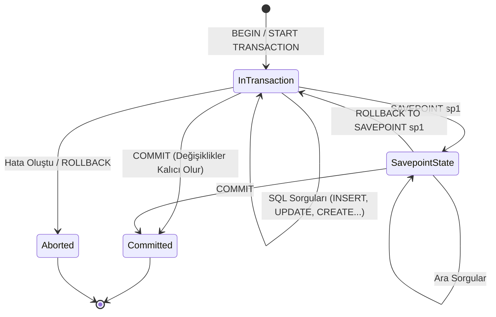

# SQL Tutor: Transaction Yönetimi ve SQL Blok Yapıları

Bu rehber, SQL'de veri bütünlüğünü sağlayan **Transaction (İşlem)** yönetimini (`BEGIN`, `COMMIT`, `ROLLBACK`, `SAVEPOINT`) ve SQL'de bu mantığa benzeyen diğer blok yapılarını detaylı açıklamalar, gerçek hayat senaryoları ve görsel şemalarla öğretmek için hazırlanmıştır.

---

## 1. Transaction (İşlem) Yönetimi Nedir?

Veritabanında birden fazla SQL komutunu tek bir mantıksal birim olarak çalıştırmak istediğimizde **Transaction** kullanırız.

### Temel Prensip: "Ya Hep Ya Hiç" (Atomicity)
Bir transaction içindeki tüm komutlar ya **tamamen başarılı olur** ve kalıcı olarak kaydedilir (`COMMIT`), ya da en ufak bir hata/aksaklıkta **hiçbiri yapılmamış gibi** başa dönülür (`ROLLBACK`).

```text
[ BAŞLA: BEGIN ]
       │
       ▼
 ┌─────────────┐
 │ 1. Adım (OK)│
 └──────┬──────┘
       ▼
 ┌─────────────┐     HATA / İPTAL
 │ 2. Adım (X) │ ───────────────────► [ ROLLBACK: Her şey sıfırlanır ]
 └──────┬──────┘
       ▼
 [ BİTİR: COMMIT: Kalıcı Kaydet ]
```

---

### Klasik Gerçek Hayat Örneği: Banka Para Transferi

Ayhan'ın hesabından (Bakiye: 1000 TL), Mehmet'in hesabına 200 TL aktarmak istiyoruz:

```sql
BEGIN; -- İşlem paketini başlat

-- 1. Adım: Ayhan'ın hesabından 200 TL düş
UPDATE accounts SET balance = balance - 200 WHERE user_name = 'Ayhan';

-- 2. Adım: Mehmet'in hesabına 200 TL ekle
UPDATE accounts SET balance = balance + 200 WHERE user_name = 'Mehmet';

COMMIT; -- İki adım da sorunsuzsa her şeyi onayla ve kaydet
```

> [!CAUTION]
> Eğer `BEGIN` ve `COMMIT` kullanmasaydık ve 1. adımdan hemen sonra sunucu kapansaydı / elektrik kesilseydi: Ayhan'ın 200 TL'si silinmiş olurdu ama Mehmet'e asla ulaşmazdı! Transaction bu tür veri kayıplarını engeller.

---

## 2. Transaction Komutları ve Akışları



### 1) `BEGIN` (veya `START TRANSACTION`)
İşlem bloğunu başlatır. Bu andan sonra yapacağınız değişiklikler diğer kullanıcılar tarafından görünmez (izolasyon) ve henüz diske kalıcı olarak yazılmaz.

### 2) `COMMIT` (veya `END`)
İşlem bloğundaki tüm değişiklikleri onaylar ve veritabanına kalıcı olarak işler.

### 3) `ROLLBACK` (veya `ABORT`)
İşlemi iptal eder. `BEGIN` anından itibaren yapılan her şeyi geri alır.

---

### 4) `SAVEPOINT` (Ara Kayıt Noktası / Checkpoint)

Büyük bir işlem zincirinde her şeyin başa dönmesini istemiyorsanız, oyunlardaki **"Save / Checkpoint"** mantığı gibi ara noktalar oluşturabilirsiniz.

```sql
BEGIN;

-- 1. İşlem: Kullanıcı tablosunu güncelle
UPDATE users SET last_login = NOW() WHERE id = 1;

-- Ara kayıt noktası oluştur
SAVEPOINT profil_guncelleme;

-- 2. İşlem: Yanlış veya riskli bir işlem dene
UPDATE profiles SET bio = 'Deneme' WHERE user_id = 999999; -- Hata veya istenmeyen durum

-- Sadece SAVEPOINT'e kadar olan kısmı geri al (1. İşlem korunur!)
ROLLBACK TO SAVEPOINT profil_guncelleme;

-- 3. İşlem: Doğru işlemle devam et
UPDATE profiles SET bio = 'Yeni Biyografi' WHERE user_id = 1;

-- Artık 1. ve 3. işlemler onaylanır
COMMIT;
```

---

### PostgreSQL'in Büyük Gücü: DDL Transaction Desteği

MySQL, Oracle gibi birçok veritabanında `CREATE TABLE`, `DROP TABLE`, `ALTER TABLE` gibi yapısal (DDL) komutlar **otomatik commit** tetikler ve geri alınamaz.

**PostgreSQL'de ise DDL komutları da Transaction içindedir!**

#### `ex02/table.sql` İçin Güvenli Yükleme Örneği:
```sql
\set ON_ERROR_STOP on

BEGIN;

-- Tabloyu sil ve yeniden oluştur
DROP TABLE IF EXISTS data_2022_oct;

CREATE TABLE data_2022_oct (
    event_time TIMESTAMPTZ,
    event_type VARCHAR(32),
    product_id INTEGER,
    price NUMERIC(10, 2),
    user_id BIGINT,
    user_session UUID
);

-- CSV yükle (Dosya yoksa hata verir)
\copy data_2022_oct FROM '../subject/customer/data_2022_oct.csv' WITH (FORMAT csv, HEADER true);

-- Eğer yukarıdaki \copy hata verirse ON_ERROR_STOP sayesinde buraya gelinmez,
-- bağlantı kapanırken otomatik ROLLBACK yapılır ve boş tablo bile oluşmaz!
COMMIT;
```

---

## 3. SQL'de `BEGIN ... COMMIT` Mantığına Benzeyen Diğer Blok Yapıları

SQL ve PostgreSQL ekosisteminde kodları bloklar halinde gruplayan, şartlara bağlayan veya zincirleme çalıştıran diğer önemli yapılar şunlardır:

---

### A. PL/pgSQL Anonim Kod Blokları (`DO $$ BEGIN ... END $$;`)

`DO` bloğu, veritabanı sunucusunda tek seferlik çalışan prosedürel bir kod bloğudur (Fonksiyon oluşturmadan doğrudan çalışır).

> [!NOTE]
> **Önemli Fark:** Buradaki `BEGIN ... END` bir transaction bloğu değil, programlama dillerindeki `{ ... }` süslü parantezi gibi bir **kod kapsamı (scope)** bloğudur.

```sql
DO $$
DECLARE
    sayac INTEGER := 0;
    toplam_kayit INTEGER;
BEGIN
    -- Değişken hesaplama
    SELECT COUNT(*) INTO toplam_kayit FROM data_2022_oct;
    
    -- Şartlı kontrol
    IF toplam_kayit > 0 THEN
        RAISE NOTICE 'Tabloda % adet kayıt var.', toplam_kayit;
    ELSE
        RAISE NOTICE 'Tablo henüz boş!';
    END IF;

-- Hata yakalama bloğu (Try-Catch gibi)
EXCEPTION
    WHEN undefined_table THEN
        RAISE NOTICE 'data_2022_oct tablosu henüz mevcut değil!';
    WHEN OTHERS THEN
        RAISE WARNING 'Beklenmeyen bir hata oluştu: %', SQLERRM;
END $$;
```

---

### B. CTE: Ortak Tablo İfadeleri (`WITH ... AS (...)`)

Bir sorguyu parçalara bölerek adım adım, geçici sanal tablolar oluşturup birbirine bağlama yapısıdır.

```sql
-- 1. Blok: Ekim 2022'de harcama yapan kullanıcılar
WITH pahali_urunler AS (
    SELECT product_id, price 
    FROM data_2022_oct 
    WHERE price > 500
),
-- 2. Blok: Bu ürünleri alan kullanıcılar
kullanici_harcamalari AS (
    SELECT user_id, SUM(price) AS toplam_harcama
    FROM data_2022_oct
    WHERE product_id IN (SELECT product_id FROM pahali_urunler)
    GROUP BY user_id
)
-- Ana Sonuç
SELECT * FROM kullanici_harcamalari 
ORDER BY toplam_harcama DESC 
LIMIT 5;
```

#### Veri Değiştiren CTE (Data-Modifying CTE)
Bir tablodan silinen veya eklenen verileri anında bir sonraki blokta kullanabilirsiniz:

```sql
WITH silinen_kayitlar AS (
    DELETE FROM eski_musteriler
    WHERE son_giris < '2020-01-01'
    RETURNING id, ad, soyad
)
INSERT INTO arsiv_musteriler (id, ad, soyad, silinme_tarihi)
SELECT id, ad, soyad, NOW() FROM silinen_kayitlar;
```

---

### C. Koşullu Mantık Bloğu (`CASE WHEN ... THEN ... ELSE ... END`)

SQL sorguları içinde `if-else if-else` mantığını satır satır çalıştırmak için kullanılır:

```sql
SELECT 
    product_id,
    price,
    CASE 
        WHEN price >= 500 THEN 'Pahalı Ürün'
        WHEN price >= 100 AND price < 500 THEN 'Orta Segment'
        WHEN price > 0 THEN 'Ekonomik Ürün'
        ELSE 'Fiyatsız / Hatalı'
    END AS urun_kategorisi
FROM data_2022_oct;
```

---

### D. Atomik Ekle/Güncelle Bloğu (`INSERT ... ON CONFLICT`) - UPSERT

"Kayıt yoksa ekle, varsa güncelle veya pas geç" işlemini tek bir atomik blokta çözer:

```sql
INSERT INTO urun_stok (product_id, stok_adedi)
VALUES (101, 10)
ON CONFLICT (product_id) -- product_id primary key ise
DO UPDATE SET 
    stok_adedi = urun_stok.stok_adedi + EXCLUDED.stok_adedi;
```

---

## 4. Karşılaştırma ve Özet Tablosu

| Yapı | Temel Amacı | Tip / Seviye | Hata Anında Ne Olur? |
| :--- | :--- | :--- | :--- |
| **`BEGIN ... COMMIT`** | Birden çok SQL sorgusunu tek bir atomik işlem yapmak | Transaction (Veri Bütünlüğü) | `ROLLBACK` ile her şey en başa döner. |
| **`SAVEPOINT`** | Transaction içinde ara kurtarma noktası oluşturmak | Alt İşlem (Sub-transaction) | Sadece o noktaya kadar geri alınır. |
| **`DO $$ BEGIN ... END $$`** | Sunucuda PL/pgSQL ile döngü, şart ve hata yönetimi çalıştırmak | Prosedürel Kod Bloğu | `EXCEPTION` bloğu ile yakalanabilir. |
| **`WITH ... AS (...)` (CTE)** | Karmaşık sorguları parçalara ayırarak geçici sonuçlar üretmek | Sorgu Düzeyi (Query Scope) | Sorgu iptal olur. |
| **`CASE ... END`** | Satır bazında değerlere göre koşullu değer üretmek | İfade Düzeyi (Expression) | Satır bazlı NULL veya varsayılan döner. |
| **`ON CONFLICT`** | Çakışma durumunda otomatik ekleme/güncelleme yapmak | DML İfadesi (Statement) | Hata üretmez, tanımlı aksiyonu alır. |

---

> [!NOTE]
> Bu rehber ihtiyaç duyuldukça yeni SQL konuları, optimizasyon yöntemleri ve pratik örneklerle genişletilebilir.

